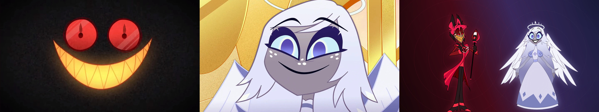
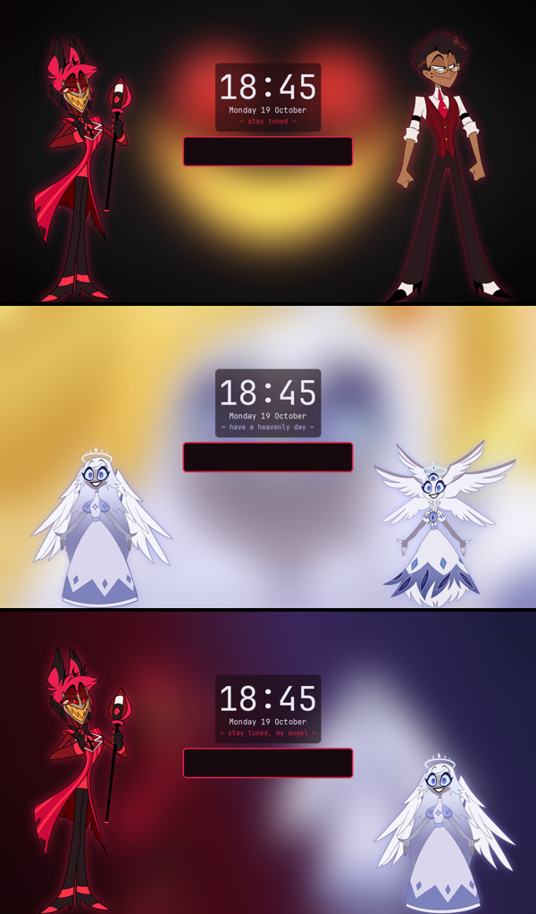

# 📻 Radiojoy for Omarchy 😇

An [Omarchy](https://omarchy.org) theme for **Alastor × Emily** (Hazbin Hotel), where
the whole desktop follows the wallpaper. Put up an Alastor wallpaper and you get
Alastor's colours, art and quotes everywhere; an Emily one gives you Emily's; a
Radiojoy one gives you both.



## What you get

| | Alastor wallpaper | Emily wallpaper | Radiojoy wallpaper |
|---|---|---|---|
| **Window border** | crimson → gold → maroon | periwinkle → lavender → halo blue | crimson → gold → periwinkle |
| **Terminal splash** | Radio Demon + 1930s Alastor | Emily + her six-winged form | Alastor + Emily |
| **Lock screen** | both his forms at the sides | both her forms | the two of them |
| **Screensaver** | his silhouettes | hers | both |
| **Bar button** | 📻 radio + devil | feather + sparkles | radio + heart + feather |
| **Spotify** (Spicetify) | maroon & gold | twilight periwinkle | theme colours |
| **Bar, menus, notifications** | maroon | twilight navy | theme colours |
| **Terminal colours** | crimson on maroon | lavender on twilight | theme colours |
| **Zen / Firefox** (opt-in) | maroon & crimson | twilight & halo blue | theme colours |

- **47 official wallpapers** in a repeating Alastor → Emily → Radiojoy order (23 Alastor,
  23 Emily, plus a picture of the pair). The radio button on the bar goes to the next one.
- **Radiojoy Week:** during the week in `radiojoy-week.txt` (2026: Oct 18–24) the bar
  button wears a ★ and shows the day's prompt, and the terminal shows it too; the rest
  of the year it counts down. While Spotify plays, the button goes **on air**.
- **Radiojoy Week wallpaper:** during the week your wallpaper becomes a collage of that
  week's art with the prompt list beside it, finished days crossed out. An hourly timer
  adds new pieces as the artists post them and switches the wallpaper to the new collage
  when it changes; after the week it's removed. List the artists in
  `~/.config/omarchy/themes/radiojoy/radiojoy-week-artists.txt` (Bluesky or Tumblr
  accounts, only ones you've checked draw by hand); with none, it shows just the prompts.
- **Terminal splash:** the art is drawn as a real image beside fastfetch and "tunes in"
  through radio static, with a quote and a little status line under it. Terminals you haven't typed in yet redraw when the wallpaper changes.
- **Lock screen:** every time you lock, the background steps to the next wallpaper in the order.
- A radio "tuning in" sound at login.




## Install

Needs Omarchy (Hyprland, Lua config) and bash. Terminal images need a terminal with
sixel support (foot, the Omarchy default, works); others get a text version.

```bash
git clone https://github.com/blade361/omarchy-radiojoy
cd omarchy-radiojoy
./install.sh
```

The installer copies the theme, scripts, bar button and a small background service,
adds python-pillow and python-numpy if missing, and switches to the theme.

| Option | |
|---|---|
| `--no-lock` | keep your current lock screen |
| `--no-splash` | don't add the terminal splash to `~/.bashrc` |
| `--no-spotify` | skip the Spotify extension |

Switching to another theme puts your borders, screensaver and lock background back to
normal; the splash and bar button only appear while Radiojoy is active.

### Lock screen

The installer clones Omarchy's own lock screen (`<you>.lock`) and adds the Radiojoy art
to it. If you already use a custom lock screen it's left alone, and so is a newer Omarchy
whose lock code has changed; everything else still works.

### Spotify

Only with [Spicetify](https://spicetify.app). The installer adds the `radiojoy-follow.js`
extension and runs `spicetify apply` once (Spotify restarts). After that, colours change
live without restarting.

### Zen / Firefox

Add this as the first line of your profile's `chrome/userChrome.css` (and enable
`toolkit.legacyUserProfileCustomizations.stylesheets` in `about:config`):

```css
@import url("radiojoy-zen.css");
```

The colours update with the wallpaper and apply the next time the browser starts.

## Uninstall

```bash
omarchy theme set tokyo-night   # any other theme
./uninstall.sh
```

## Fan art

These Radiojoy pieces aren't included because they belong to their artists, but
they're lovely as wallpapers. Get them from the artists, and if you add them to
`~/.config/omarchy/backgrounds/radiojoy/`, name them `NN-radiojoy-name.jpg` to slot
them into the order.

- Dragonfoxgirl: [Holy Light](https://www.deviantart.com/dragonfoxgirl/art/Holy-Light.-1273980120),
  [Oops](https://www.deviantart.com/dragonfoxgirl/art/Oops-1262499961),
  [She Listens](https://www.deviantart.com/dragonfoxgirl/art/She-Listens.-1347366914),
  [You Promised To Be Good!](https://www.deviantart.com/dragonfoxgirl/art/You-Promised-To-Be-Good%21-1260603204),
  [Your concern is wasted on this Little Dove](https://www.deviantart.com/dragonfoxgirl/art/Your-concern-is-wasted-on-this-Little-Dove-1341538897),
  [Annoying little angel on my shoulder](https://www.deviantart.com/dragonfoxgirl/art/Annoying-little-angel-on-my-shoulder-1277248105),
  [Al Al Al!](https://www.deviantart.com/dragonfoxgirl/art/Al-Al-Al%21-1233950345)
- RadioJoy Enjoyer ([Bluesky](https://bsky.app/profile/radiojoyenjoyer.bsky.social), X @RadioJoyEnjoyer):
  Radiojoy Week 2026 [Day 1 "Fallen Emily"](https://bsky.app/profile/radiojoyenjoyer.bsky.social/post/3my6zctsua227),
  [Day 2 "Dove/Shadow"](https://bsky.app/profile/radiojoyenjoyer.bsky.social/post/3myayejcjqs2e),
  [Doodling!](https://bsky.app/profile/radiojoyenjoyer.bsky.social/post/3mxxnxxevzk2x),
  [My parents](https://bsky.app/profile/radiojoyenjoyer.bsky.social/post/3msyqfqud2227).
  Please don't repost their art; they ask people not to.
- termsandfeathers: Radiojoy Week 2026 [Day 1](https://www.tumblr.com/termsandfeathers/830853127253196800)
  and [Day 2](https://www.tumblr.com/termsandfeathers/830907476634451968) sketches, [cherry blossoms](https://www.tumblr.com/termsandfeathers/814820394436640768),
  [50 followers Q+A](https://www.tumblr.com/termsandfeathers/816085258794614784),
  ["This is dangerous"](https://www.tumblr.com/termsandfeathers/812903677665968128)
- Pikagalaxy30: [Alastor x Emily](https://www.deviantart.com/pikagalaxy30/art/Alastor-x-Emily-%28Hazbin-Hotel%2C-Radiojoy%29-1267936052)
- OctoDemon: [RadioJoy](https://www.deviantart.com/octodemon/art/RadioJoy-1381048921)
- MadridStone: [Date Night](https://www.deviantart.com/madridstone/art/Date-Night-%28RadioJoy%29-1332050081)
- sPitter: [Feral Alastor giving Emily a lift](https://www.deviantart.com/spitter/art/Feral-Alastor-giving-Emily-a-lift-1327810953)

## Credits

- Hazbin Hotel, Alastor and Emily © Vivienne Medrano / A24 / Prime Video. The wallpapers,
  character renders and stills come from the [Hazbin Hotel wiki](https://hazbinhotel.fandom.com).
  This is an unofficial fan project.
- The lock screen builds on Omarchy's lock plugin ([MIT](https://github.com/basecamp/omarchy)).
- The scripts, theme files and login sound in this repo are MIT licensed (see LICENSE).
  The art is not; it belongs to its owners.
